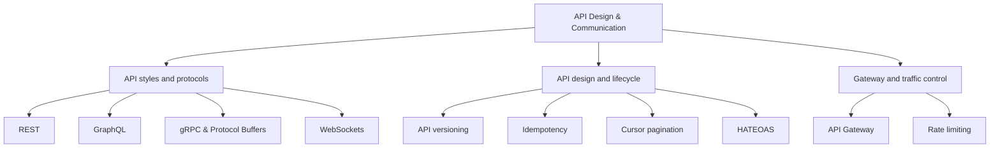

# 🌐 API Design & Communication

One Java 21 learning repository for the design of APIs, their communication
protocols, and the policies that make them reliable to consume. It contains
ten standalone Gradle modules grouped into three connected areas. Each topic
has a guide, runnable example, and tests; external servers and cloud accounts
are not required.

## Learning map



## Explore the subcategories

| Subcategory | Focus | Topics |
| --- | --- | --- |
| [API styles and protocols](api-styles/README.md) | Choose how clients and services exchange requests and data. | [REST](api-styles/rest/README.md) · [GraphQL](api-styles/graphql/README.md) · [gRPC & Protocol Buffers](api-styles/grpc/README.md) · [WebSockets](api-styles/websockets/README.md) |
| [API design and lifecycle](api-lifecycle/README.md) | Evolve contracts and make client interactions dependable. | [Versioning](api-lifecycle/versioning/README.md) · [Idempotency](api-lifecycle/idempotency/README.md) · [Pagination](api-lifecycle/pagination/README.md) · [HATEOAS](api-lifecycle/hateoas/README.md) |
| [Gateway and traffic control](gateway-traffic/README.md) | Centralize routing and protect services from excess demand. | [API Gateway](gateway-traffic/api-gateway/README.md) · [Rate limiting](gateway-traffic/rate-limiting/README.md) |

## Build and test

Install JDK 21, then run from this repository root:

```sh
./gradlew test
./gradlew build
./gradlew :api-styles:rest:test
```

The Gradle Wrapper pins Gradle 9.8.1 and verifies the distribution checksum.
The examples use local/in-memory adapters where an external service would
distract from the API design. REST, GraphQL, gRPC, and WebSocket examples
exercise their actual protocol or framework contracts in tests.
