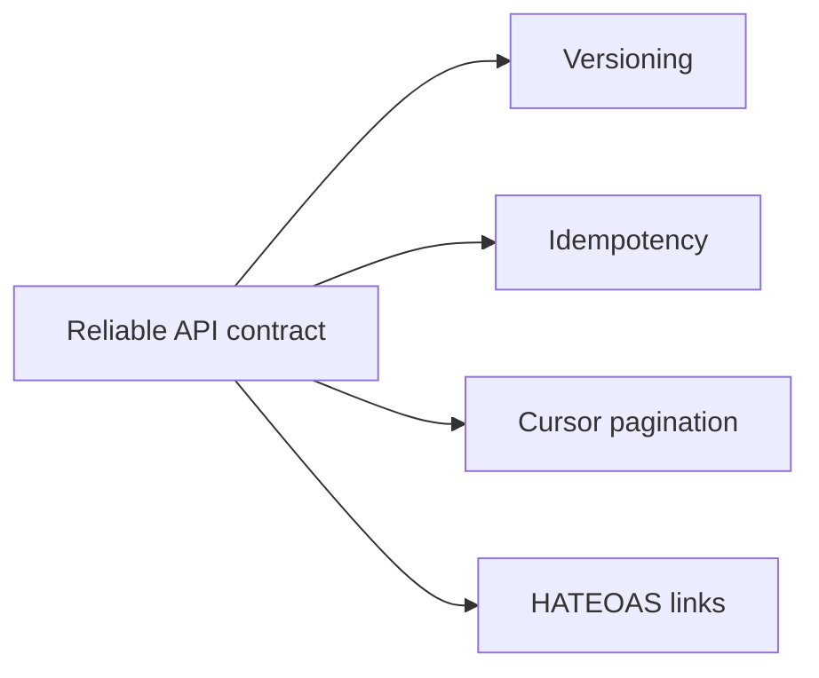

# API design and lifecycle

Good APIs remain usable as they grow: callers can evolve at a predictable pace,
retry safely, traverse large collections, and discover available actions.

| Topic | Use it to learn |
| --- | --- |
| [API versioning](versioning/README.md) | Explicit URL/media-type version negotiation and compatibility boundaries. |
| [Idempotency](idempotency/README.md) | Safe request retries, key scope, payload conflicts, and replayed responses. |
| [Pagination](pagination/README.md) | Stable keyset pagination with opaque, integrity-protected cursors. |
| [HATEOAS](hateoas/README.md) | Discover resource actions through links and current resource state. |

Return to the [Module 5 map](../README.md).
