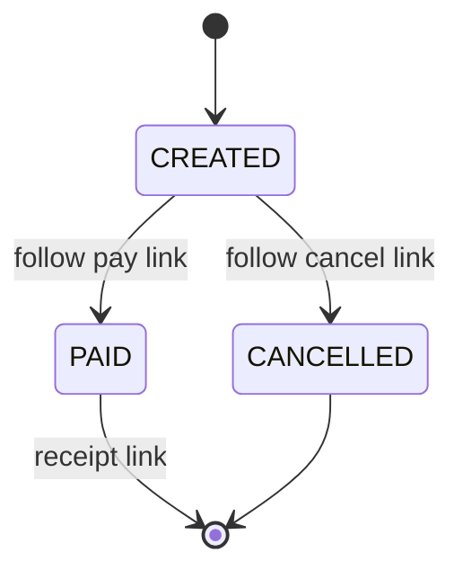

# HATEOAS

Hypermedia links let a client discover valid next actions from the resource
representation instead of hard-coding every workflow transition. This example
publishes links based on the current order state: a new order can be paid or
cancelled, while a paid order has a receipt link.

Links describe actions the server currently offers; authorization and state
validation still happen when an action is requested. A link is not an access
control mechanism.

Example: [`OrderRepresentation`](src/main/java/com/absolutebonkers/apidesign/hateoas/OrderRepresentation.java) ·
Tests: [`OrderRepresentationTest`](src/test/java/com/absolutebonkers/apidesign/hateoas/OrderRepresentationTest.java).

Run with `./gradlew :api-lifecycle:hateoas:test`.
