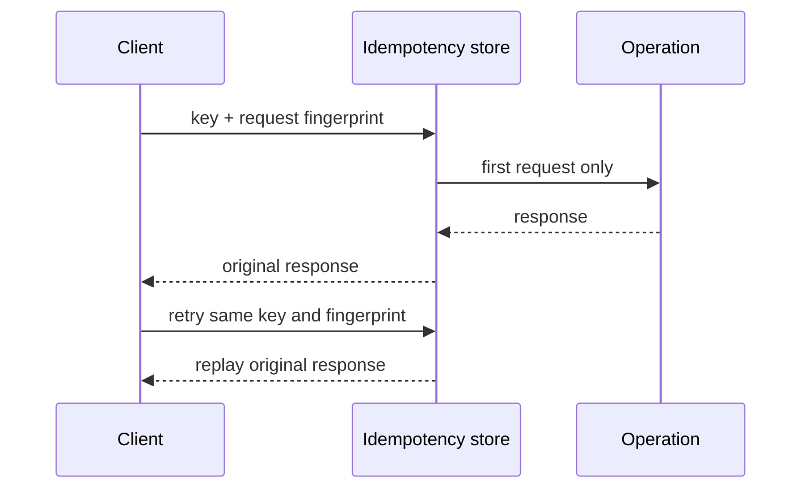

# Idempotency

An idempotency key lets a client retry a state-changing request without
creating the effect twice. This thread-safe in-memory example scopes keys,
binds each key to a request fingerprint, replays the original response, and
rejects reuse of the key with different input. Failed executions are removed
so a later retry can attempt the operation again.

The store is process-local and expires completed keys; a production payment or
order API needs durable shared storage, a carefully chosen retention window,
and the same transaction boundary as the side effect.

Example: [`IdempotencyStore`](src/main/java/com/absolutebonkers/apidesign/idempotency/IdempotencyStore.java) ·
Tests: [`IdempotencyStoreTest`](src/test/java/com/absolutebonkers/apidesign/idempotency/IdempotencyStoreTest.java).

Run with `./gradlew :api-lifecycle:idempotency:test`.
