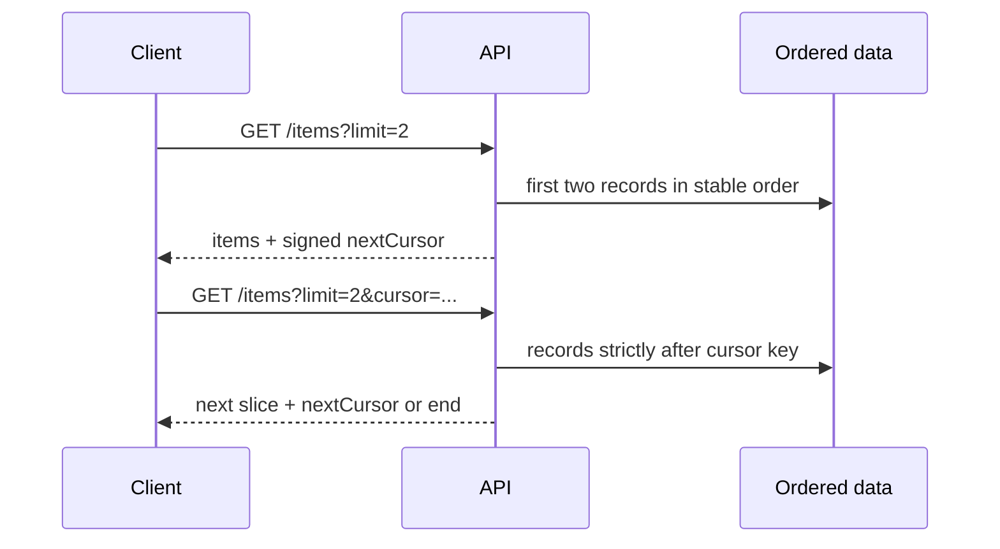

# Cursor pagination

Cursor pagination returns a bounded slice and an opaque pointer to the next
slice. This example sorts by a stable `(createdAt, id)` key, so records with
the same timestamp are not skipped or repeated. HMAC authentication detects
client edits to the cursor.

The signing secret must be strong and consistently shared by API instances.
Cursor pagination is not a snapshot: concurrent inserts/deletes can affect
later pages. Define ordering and consistency requirements for the real store.

| Approach | Example | Strength | Trade-off |
| --- | --- | --- | --- |
| Offset | [`OffsetPager`](src/main/java/com/absolutebonkers/apidesign/pagination/OffsetPager.java), `?offset=100&limit=20` | Simple; supports jumping to a numbered page. | Large offsets can be expensive, and inserts/deletes before the offset can shift results between requests. |
| Cursor | [`CatalogPager`](src/main/java/com/absolutebonkers/apidesign/pagination/CatalogPager.java), `?after=...&limit=20` | Efficient for large ordered collections and less prone to shifting as earlier rows change. | Requires a deterministic sort key; jumping to an arbitrary page is not natural. |

Examples: [`OffsetPager`](src/main/java/com/absolutebonkers/apidesign/pagination/OffsetPager.java),
[`CatalogPager`](src/main/java/com/absolutebonkers/apidesign/pagination/CatalogPager.java),
[`CursorCodec`](src/main/java/com/absolutebonkers/apidesign/pagination/CursorCodec.java) ·
Tests: [`CatalogPagerTest`](src/test/java/com/absolutebonkers/apidesign/pagination/CatalogPagerTest.java).

Run with `./gradlew :api-lifecycle:pagination:test`.

## Sources

[Google AIP-158: Pagination](https://google.aip.dev/158) describes page-size,
continuation-token, and stable-request-parameter expectations for paginated APIs.
