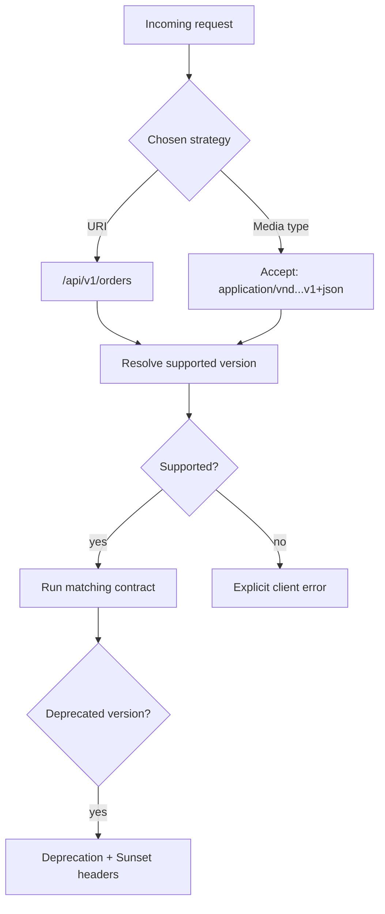

# API versioning

Versioning makes a breaking contract change explicit. This module demonstrates
two common, intentionally separate strategies: versioned resource paths and
vendor media types in `Accept`. It rejects missing and unsupported versions,
honors media-range quality values, and marks the old version as deprecated.
When a client accepts multiple versions equally, the newest supported version
wins.

Pick one strategy for a given API; supporting several simultaneously without
clear precedence creates ambiguity. A version is a compatibility boundary,
not a substitute for additive changes and a documented deprecation policy.

Examples: [`ApiVersionNegotiator`](src/main/java/com/absolutebonkers/apidesign/versioning/ApiVersionNegotiator.java) ·
Tests: [`ApiVersionNegotiatorTest`](src/test/java/com/absolutebonkers/apidesign/versioning/ApiVersionNegotiatorTest.java).

Run with `./gradlew :api-lifecycle:versioning:test`.
