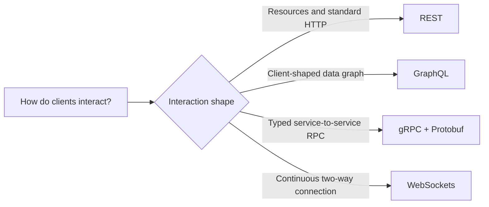

# API styles and protocols

Choose an interaction style based on the shape of the client, data, and
communication—not fashion. These options are complementary, not mutually
exclusive.

| Topic | Use it to learn |
| --- | --- |
| [REST](rest/README.md) | Resource-oriented HTTP, methods, status codes, validation, and JSON. |
| [GraphQL](graphql/README.md) | Schema-first queries, typed fields, resolvers, and execution errors. |
| [gRPC & Protocol Buffers](grpc/README.md) | A typed RPC contract, generated Java stubs, and unary calls over HTTP/2. |
| [WebSockets](websockets/README.md) | A real full-duplex connection, server lifecycle, and message exchange. |

Return to the [Module 5 map](../README.md).
