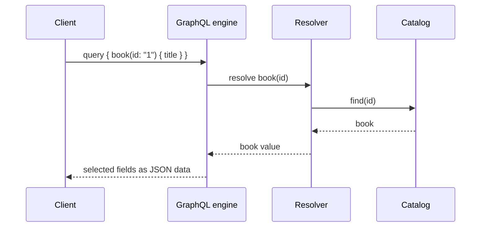

# GraphQL

This module defines a typed schema and executes client-selected fields through
GraphQL Java. The resolver reads from a small catalog; GraphQL validates the
query, coerces arguments, resolves fields, and reports execution errors.

The module exercises schema execution rather than implementing an
HTTP/GraphQL transport. Production deployments still need transport-level
authentication, query-depth/complexity limits, batching, and observability.

Examples: [`BookGraphQl`](src/main/java/com/absolutebonkers/apidesign/graphql/BookGraphQl.java) ·
Tests: [`BookGraphQlTest`](src/test/java/com/absolutebonkers/apidesign/graphql/BookGraphQlTest.java).

Run with `./gradlew :api-styles:graphql:test`.

## Sources

[GraphQL specification](https://spec.graphql.org/October2021/), including its
[type system](https://spec.graphql.org/October2021/#sec-Type-System) and
[validation rules](https://spec.graphql.org/October2021/#sec-Validation).
