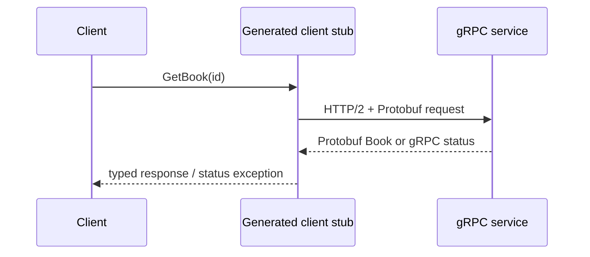

# gRPC & Protocol Buffers

The `.proto` file is the language-neutral service contract. Gradle generates
Java message classes and gRPC stubs from that contract; the example starts a
real local gRPC server and calls it through a generated blocking stub.

The unary RPC illustrates typed request/response messages and `NOT_FOUND`.
Production systems must additionally define authentication, deadlines,
retries, metadata, compatibility rules, and transport security.

Contract: [`book_service.proto`](src/main/proto/book_service.proto) ·
Implementation: [`BookService`](src/main/java/com/absolutebonkers/apidesign/grpc/BookService.java) ·
Tests: [`BookServiceTest`](src/test/java/com/absolutebonkers/apidesign/grpc/BookServiceTest.java).

Run with `./gradlew :api-styles:grpc:test`; the task generates Java sources
from the checked-in Protocol Buffers contract.

## Sources

[gRPC core concepts](https://grpc.io/docs/what-is-grpc/core-concepts/),
[Protocol Buffers proto3 language guide](https://protobuf.dev/programming-guides/proto3/).
