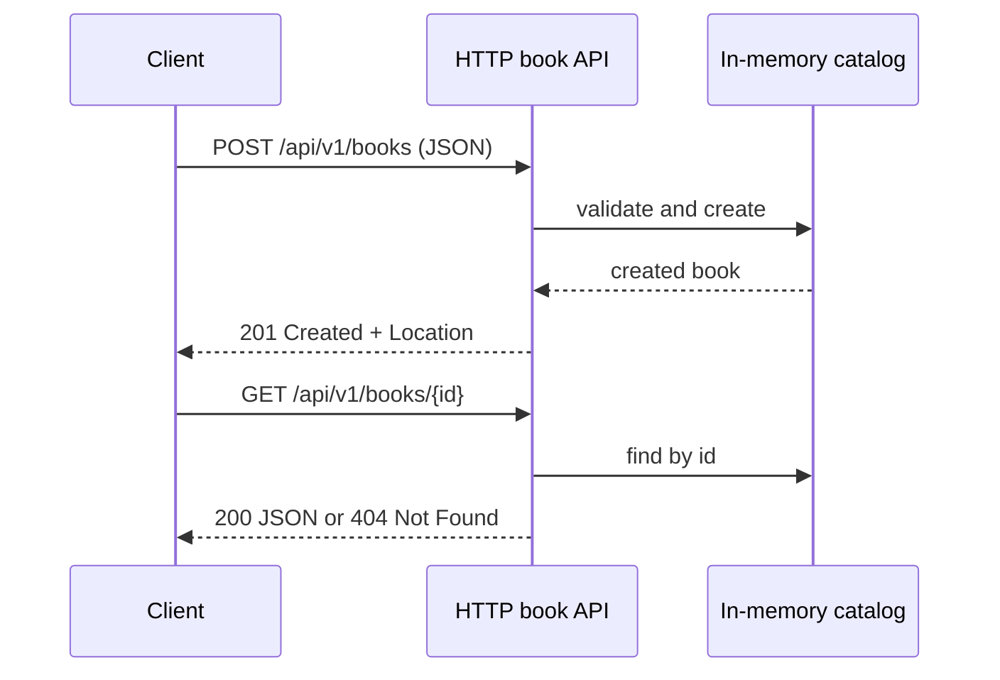

# REST API design

This module runs a small JSON book API on the JDK HTTP server. It uses nouns
for resources, HTTP methods for actions, status codes for outcomes, validates
request bodies, returns a `Location` after creation, and distinguishes missing
resources from malformed requests.

| Request | Success | Other behavior |
| --- | --- | --- |
| `GET /api/v1/books` | `200` with a JSON array | JSON content negotiation |
| `GET /api/v1/books/{id}` | `200` with a JSON book | `404` when no book exists |
| `POST /api/v1/books` | `201`, JSON book, and `Location` | `400` invalid JSON, `413` oversized body, `415` unsupported media type, `422` invalid fields |

The in-memory catalog and loopback server keep this example self-contained;
replace the catalog with a repository adapter for a persistent service.

Examples: [`BookApiServer`](src/main/java/com/absolutebonkers/apidesign/rest/BookApiServer.java),
[`BookCatalog`](src/main/java/com/absolutebonkers/apidesign/rest/BookCatalog.java) ·
Tests: [`BookApiServerTest`](src/test/java/com/absolutebonkers/apidesign/rest/BookApiServerTest.java).

Run with `./gradlew :api-styles:rest:test`.

## Sources

[HTTP Semantics (RFC 9110)](https://www.rfc-editor.org/rfc/rfc9110.html),
[Roy Fielding's REST architectural style](https://ics.uci.edu/~fielding/pubs/dissertation/rest_arch_style.htm).
