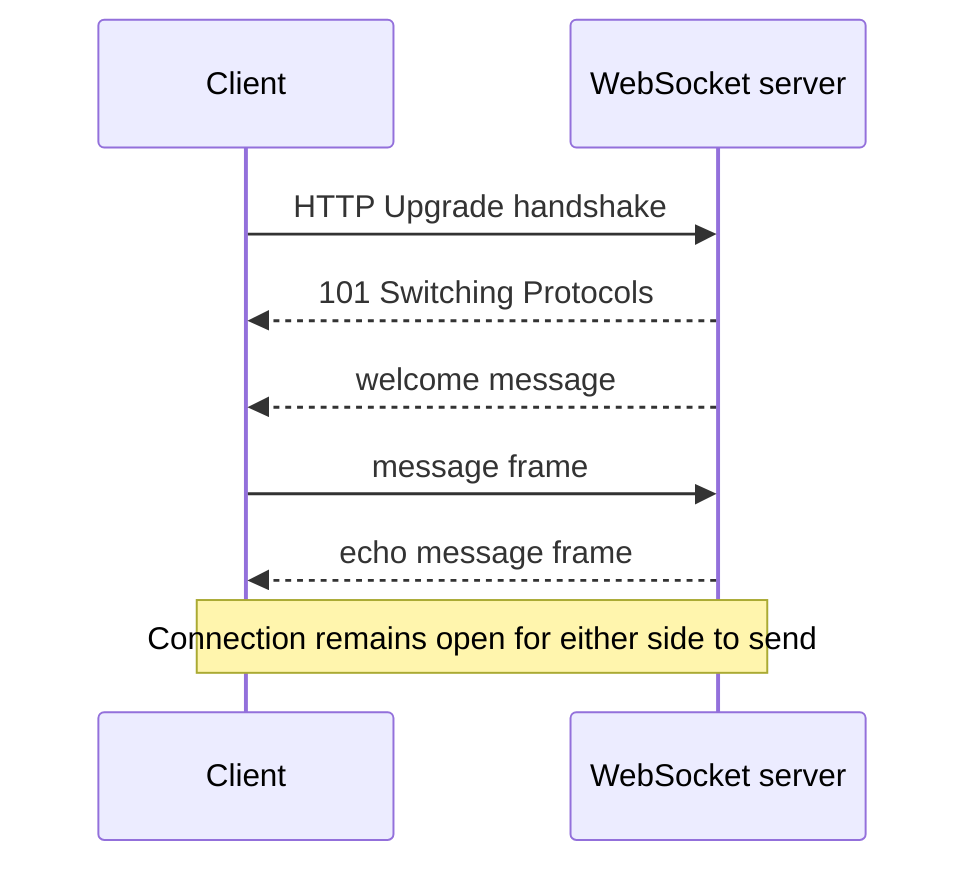

# WebSockets

This module starts a real RFC 6455 WebSocket server and connects a test client.
It demonstrates the HTTP upgrade, connection lifecycle, and full-duplex text
messages; the server responds to each message without opening a new HTTP
request.

The echo server is a transport example, not a production chat service. Real
systems must define authentication, origin policy, message limits, heartbeat
and idle timeout behavior, backpressure, and horizontal fan-out.

Implementation: [`EchoWebSocketServer`](src/main/java/com/absolutebonkers/apidesign/websockets/EchoWebSocketServer.java) ·
Integration test: [`EchoWebSocketServerTest`](src/test/java/com/absolutebonkers/apidesign/websockets/EchoWebSocketServerTest.java).

Run with `./gradlew :api-styles:websockets:test`.

## Sources

[The WebSocket Protocol (RFC 6455)](https://www.rfc-editor.org/rfc/rfc6455.html).
