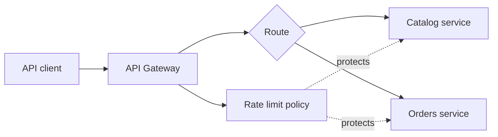

# Gateway and traffic control

An API gateway is a carefully bounded edge that routes client requests toward
services. Traffic controls protect those services; centralizing them should
not hide important service behavior from operators.

| Topic | Use it to learn |
| --- | --- |
| [API Gateway](api-gateway/README.md) | Route selection, path forwarding, shared credentials, and boundary behavior. |
| [Rate limiting](rate-limiting/README.md) | A thread-safe token bucket, burst capacity, refill, and retry guidance. |

Return to the [Module 5 map](../README.md).
