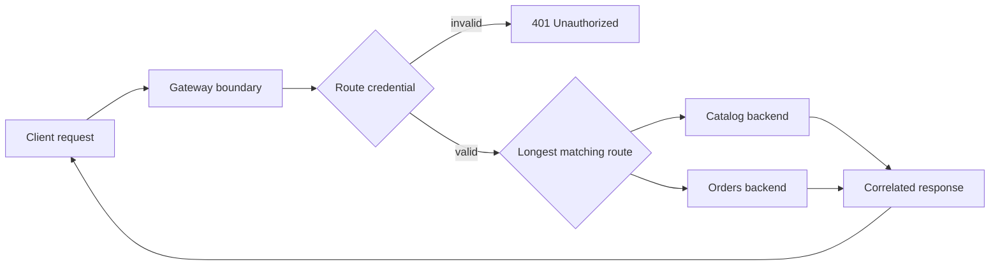

# API Gateway pattern

The gateway is a narrow edge that selects the most specific configured route,
checks route credentials, forwards to a backend path, and adds a request
correlation ID. It removes the client API key, client-supplied correlation ID,
hop-by-hop headers, and untrusted forwarding metadata before forwarding; it
converts known backend-unavailable failures into `502 Bad Gateway`.

This in-process router focuses on the gateway's boundary behavior; it does not
claim to replace a production proxy. Real gateways need explicit timeouts,
health-aware load balancing, telemetry, TLS policy, and a plan for retry safety.

Examples: [`ApiGateway`](src/main/java/com/absolutebonkers/apidesign/gateway/ApiGateway.java),
[`GatewayRoute`](src/main/java/com/absolutebonkers/apidesign/gateway/GatewayRoute.java) ·
Tests: [`ApiGatewayTest`](src/test/java/com/absolutebonkers/apidesign/gateway/ApiGatewayTest.java).

Run with `./gradlew :gateway-traffic:api-gateway:test`.
