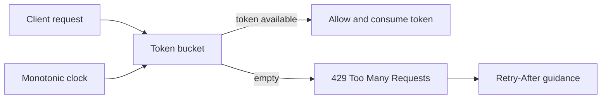

# Rate limiting and throttling

The token bucket allows a bounded burst and replenishes capacity at a steady
rate. A rejected request receives a retry delay; separate client keys get
independent buckets. Bucket updates are synchronized so concurrent requests
cannot consume the same token twice.

This is a single-process teaching implementation. A production deployment
needs shared/distributed state or deliberate per-instance limits, bounded key
cardinality, policy configuration, and a documented response contract.
Distributed gateway throttles may be best-effort targets rather than strict
global ceilings, depending on the provider and configuration.

Example: [`TokenBucketRateLimiter`](src/main/java/com/absolutebonkers/apidesign/ratelimit/TokenBucketRateLimiter.java) ·
Tests: [`TokenBucketRateLimiterTest`](src/test/java/com/absolutebonkers/apidesign/ratelimit/TokenBucketRateLimiterTest.java).

Run with `./gradlew :gateway-traffic:rate-limiting:test`.

## Sources

[Amazon API Gateway throttling](https://docs.aws.amazon.com/apigateway/latest/developerguide/http-api-throttling.html)
documents token-bucket rate and burst limits;
[HTTP 429 Too Many Requests (RFC 6585)](https://www.rfc-editor.org/rfc/rfc6585.html#section-4)
defines the response status used for throttling.
